<b>Language:</b>

  
  

<!-- HEADER -->

  

  

  
  &nbsp;
  
  &nbsp;
  

  📍 Guarulhos, São Paulo, Brazil &nbsp;•&nbsp; 🎯 Targeting <b>Junior Front-end Developer</b> & <b>Software Development Internship</b> roles

---

## 👩🏻‍💻 About Me

I am an early-career Front-end Developer. I design and build responsive, accessible, and interactive interfaces using **semantic HTML, CSS, and vanilla JavaScript**, delivering every single project with **open-source code and live deployment**.

- 🎓 **Technical Foundation:** Systems Analysis and Development (FATEC-SP) and AWS re/Start graduate (Cloud Computing).

- 💻 **Ongoing Training:** Full Stack Development at DevClub, focusing on modern JavaScript (ES6+) and RESTful API consumption.

- ♿ **Digital Accessibility (a11y) Edge:** Academic background in **Digital Accessibility and Sign Language (Libras)**. In my latest projects ([Giro Sorteador](https://github.com/paulaPSOx/giro-sorteador), [Netflix Clone](https://github.com/paulaPSOx/clone-netflix), and [Marvel Character Select](https://github.com/paulaPSOx/marvel-selecao-de-personagem)), I actively implement semantic ARIA attributes, focus trapping, and keyboard-first navigation.

- 📝 **Technical Documentation:** Every repository features an "Under the Hood" breakdown explaining engineering tradeoffs, technical decisions, and a roadmap of upcoming features.

---

## 🛠️ Tech Stack & Tools

  

 

| Domain | What I use |
| :-- | :-- |
| **Front-end** | Semantic HTML5, CSS3 (Flexbox, Grid, CSS Variables, keyframe animations, media queries), and JavaScript ES6+ (DOM manipulation, event delegation, `async/await`, `fetch`) |
| **Web Browser APIs** | Geolocation API, 2D Canvas, Web Crypto API, `localStorage`, Audio API |
| **Version Control & DevOps** | Git & GitHub (Feature Branch Workflow, Conventional Commits, GitHub Actions CI/CD, GitHub Pages) |
| **Cloud (AWS)** | Cloud Computing Architecture fundamentals: EC2, S3, IAM, VPC |
| **Currently Learning** | React.js and Node.js |

---

## 🌟 Featured Projects

<table>
  <tr>
    <td width="50%" valign="top">
      <h3>🌦️ Weather Forecast (Clima Tempo)</h3>
      
Real-time weather application searching by <b>city name</b> or automatically detected via <b>native Geolocation</b>, consuming the OpenWeatherMap REST API. Dynamic styling switches the theme based on local sun position and time zones.

      
<b>Key Learnings:</b> Asynchronous <code>fetch</code> with <code>async/await</code>, defensive error handling, and Geolocation API integration.

      

        <a href="https://paulapsox.github.io/clima-tempo/" target="_blank" rel="noopener noreferrer">▶ Live Demo</a> &nbsp;•&nbsp;
        <a href="https://github.com/paulaPSOx/clima-tempo">💻 Source Code</a>
      

    </td>
    <td width="50%" valign="top">
      <h3>🎲 Lucky Draw (Giro Sorteador)</h3>
      
Custom draw platform for both numerical ranges and name pools, featuring non-repeating results, persistent history across sessions, and celebratory canvas confetti.

      
<b>Key Learnings:</b> Cryptographically secure randomness via <code>crypto.getRandomValues</code>, large integers with <code>BigInt</code>, state persistence using <code>localStorage</code>, and ARIA tabs/dialog patterns.

      

        <a href="https://paulapsox.github.io/giro-sorteador/" target="_blank" rel="noopener noreferrer">▶ Live Demo</a> &nbsp;•&nbsp;
        <a href="https://github.com/paulaPSOx/giro-sorteador">💻 Source Code</a>
      

    </td>
  </tr>
  <tr>
    <td width="50%" valign="top">
      <h3>🎬 PaulaPSOxFlix (Netflix Clone)</h3>
      
Media streaming home interface featuring horizontal carousel sliders, embedded video trailer modal, collapsible FAQ accordion, and local profile selector.

      
<b>Key Learnings:</b> Fully accessible modal with <code>aria-modal="true"</code>, programmatic focus trapping for keyboard accessibility, and user preference caching via <code>localStorage</code>.

      

        <a href="https://paulapsox.github.io/clone-netflix/" target="_blank" rel="noopener noreferrer">▶ Live Demo</a> &nbsp;•&nbsp;
        <a href="https://github.com/paulaPSOx/clone-netflix">💻 Source Code</a>
      

    </td>
    <td width="50%" valign="top">
      <h3>🍄 Super Mario Bros – The Movie</h3>
      
Interactive 4-page promotional website with trailer modal integration, character audio soundboard, memory pair matching game, and a star-rating review form.

      
<b>Key Learnings:</b> Multi-page navigation, state machine logic for card flipping and match verification, audio triggers, and form input validation.

      

        <a href="https://paulapsox.github.io/super-mario-bros-o-filme/" target="_blank" rel="noopener noreferrer">▶ Live Demo</a> &nbsp;•&nbsp;
        <a href="https://github.com/paulaPSOx/super-mario-bros-o-filme">💻 Source Code</a>
      

    </td>
  </tr>
</table>

---

## 🧩 Skill to Project Matrix

| Technical Skill | Referenced Repository |
| :-- | :-- |
| **REST API Consumption, `fetch`, and Geolocation** | [Clima Tempo](https://github.com/paulaPSOx/clima-tempo) |
| **Web Crypto API, `BigInt`, and Data Validation** | [Giro Sorteador](https://github.com/paulaPSOx/giro-sorteador) |
| **2D Canvas API and `requestAnimationFrame` loops** | [Fireworks Message Generator](https://github.com/paulaPSOx/fireworks-message-generator) |
| **`localStorage` (State caching and theme persistence)** | [Giro Sorteador](https://github.com/paulaPSOx/giro-sorteador) • [Netflix Clone](https://github.com/paulaPSOx/clone-netflix) • [Pokémon](https://github.com/paulaPSOx/pokemon-cards) • [Sonic x Shadow](https://github.com/paulaPSOx/sonic-shadow-generations) |
| **Theming with CSS Variables & 3D CSS Perspectives** | [Sonic x Shadow](https://github.com/paulaPSOx/sonic-shadow-generations) • [Pokémon](https://github.com/paulaPSOx/pokemon-cards) |
| **Digital Accessibility (WAI-ARIA, Focus Trapping, Keyboard UX)** | [Giro Sorteador](https://github.com/paulaPSOx/giro-sorteador) • [Netflix Clone](https://github.com/paulaPSOx/clone-netflix) • [Marvel](https://github.com/paulaPSOx/marvel-selecao-de-personagem) |
| **Audio and Media Manipulation via JavaScript** | [Super Mario](https://github.com/paulaPSOx/super-mario-bros-o-filme) • [Ben 10](https://github.com/paulaPSOx/ben-10) • [Sonic x Shadow](https://github.com/paulaPSOx/sonic-shadow-generations) |
| **CI/CD Automation with GitHub Actions** | This repository profile (automated contribution chart generation) |

---

## 💻 All Projects

> Built with **clean semantic HTML, modern CSS, and vanilla JavaScript** without third-party frameworks, solidifying deep web fundamentals.

### ⚙️ Applications (Logic & Data)
| Project | Technical Highlight | Live Demo | Repository |
| :-- | :-- | :--: | :--: |
| 🌦️ **Clima Tempo** | Weather API, geolocation tracking, and real-time timezone theming | [Launch](https://paulapsox.github.io/clima-tempo/) | [Code](https://github.com/paulaPSOx/clima-tempo) |
| 🎲 **Giro Sorteador** | Cryptographic randomness, array manipulation, and ARIA components | [Launch](https://paulapsox.github.io/giro-sorteador/) | [Code](https://github.com/paulaPSOx/giro-sorteador) |
| 🎆 **Fireworks Generator** | 2D Canvas rendering, simulated particle physics, and motion velocity | [Launch](https://paulapsox.github.io/fireworks-message-generator/) | [Code](https://github.com/paulaPSOx/fireworks-message-generator) |
| 🚀 **JavaScript Portfolio (Proj-JS)** | 10 foundational algorithms: BMI, guessing game, digital clock, etc. | [Launch](https://paulapsox.github.io/Proj-JS/) | [Code](https://github.com/paulaPSOx/Proj-JS) |

### 🖼️ UI Clones & Layouts
| Project | Technical Highlight | Live Demo | Repository |
| :-- | :-- | :--: | :--: |
| 🎬 **PaulaPSOxFlix (Netflix Clone)** | Responsive carousels, accessible modal dialogues, and local caching | [Launch](https://paulapsox.github.io/clone-netflix/) | [Code](https://github.com/paulaPSOx/clone-netflix) |
| 📸 **Instagram UI Clone** | High-fidelity screen clone, defensive form input parsing, and slideshow | [Launch](https://paulapsox.github.io/instagram-login-clone/) | [Code](https://github.com/paulaPSOx/instagram-login-clone) |

### 🎮 Themed & Interactive Experiences
| Project | Technical Highlight | Live Demo | Repository |
| :-- | :-- | :--: | :--: |
| 🍄 **Super Mario Bros – The Movie** | 4 connected pages, card-matching memory logic, and custom audio triggers | [Launch](https://paulapsox.github.io/super-mario-bros-o-filme/) | [Code](https://github.com/paulaPSOx/super-mario-bros-o-filme) |
| 🦸 **Marvel – Character Select** | 2-player local selection logic, choice lock-in, and keyboard input routing | [Launch](https://paulapsox.github.io/marvel-selecao-de-personagem/) | [Code](https://github.com/paulaPSOx/marvel-selecao-de-personagem) |
| 🐞 **Miraculous Ladybug** | Multi-page catalog navigation, responsive hero layouts, and animations | [Launch](https://paulapsox.github.io/miraculous-ladybug/) | [Code](https://github.com/paulaPSOx/miraculous-ladybug) |
| 🔴 **Pokémon – Card Showcase** | 3D tilt perspective animations on hover and dynamic light/dark theme switch | [Launch](https://paulapsox.github.io/pokemon-cards/) | [Code](https://github.com/paulaPSOx/pokemon-cards) |
| ⚡ **Sonic x Shadow Generations** | Design System architected with CSS variables and autonomous image rotator | [Launch](https://paulapsox.github.io/sonic-shadow-generations/) | [Code](https://github.com/paulaPSOx/sonic-shadow-generations) |
| ⌚ **Ben 10** | Radial radial-menu layout calculated via sine and cosine trigonometry | [Launch](https://paulapsox.github.io/ben-10/) | [Code](https://github.com/paulaPSOx/ben-10) |
| 🚲 **Stranger Things** | Fullscreen banner slider and art-direction image swaps via media queries | [Launch](https://paulapsox.github.io/stranger-things/) | [Code](https://github.com/paulaPSOx/stranger-things) |
| 🧚‍♀️ **Winx Club** | Dynamic state toggling driven strictly by HTML `data-*` attributes | [Launch](https://paulapsox.github.io/clube-das-winx/) | [Code](https://github.com/paulaPSOx/clube-das-winx) |
| 🪐 **The Solar System** | Interactive planetary viewer with state-driven view switches | [Launch](https://paulapsox.github.io/sistema-solar/) | [Code](https://github.com/paulaPSOx/sistema-solar) |

> *Disclaimer: All themed projects are created strictly for educational and portfolio demonstration purposes. All characters, brands, and multimedia assets belong to their respective copyright holders.*

---

## 🎓 Education & Certifications

- **Associate Degree in Systems Analysis and Development (ADS)** — São Paulo State Faculty of Technology (FATEC-SP)

- **AWS re/Start Graduate** — Cloud Computing fundamentals (EC2, S3, IAM, and VPC)

- **Full Stack Web Development** — DevClub (currently enrolled)

---

## 📬 Let's Connect!

  
  &nbsp;
  

---

## 👾 Contribution Graph (Pac-Man)

  <picture>
    <source media="(prefers-color-scheme: dark)" srcset="https://raw.githubusercontent.com/paulaPSOx/paulaPSOx/output/pacman-contribution-graph-dark.svg">
    <source media="(prefers-color-scheme: light)" srcset="https://raw.githubusercontent.com/paulaPSOx/paulaPSOx/output/pacman-contribution-graph.svg">
    
  </picture>
    
  
   
  Automated workflow executed periodically by GitHub Actions to pull from the <code>output</code> branch and render the vector SVG based on commit history.

 

  

