<b>Idioma:</b>

  
  

<!-- CABEÇALHO -->

  

  

  
  
  

  📍 Guarulhos, São Paulo, Brasil &nbsp;•&nbsp; 🎯 Vagas de <b>Front-end Júnior</b> e <b>Estágio em Desenvolvimento</b>

---

## 👩🏻‍💻 Sobre mim

Sou desenvolvedora front-end em início de carreira. Construo interfaces responsivas e interativas com **HTML, CSS e JavaScript puro**, e publico cada projeto com **código aberto e demonstração online**.

- 🎓 **Base técnica:** Análise e Desenvolvimento de Sistemas (FATEC-SP) e AWS re/Start (Cloud Computing).
- 💻 **Formação atual:** Full Stack no DevClub, com foco em JavaScript moderno (ES6+) e consumo de APIs REST.
- ♿ **Diferencial:** pesquisa acadêmica em **Acessibilidade Digital e Libras**. Nos projetos mais recentes ([Giro Sorteador](https://github.com/paulaPSOx/giro-sorteador), [Clone Netflix](https://github.com/paulaPSOx/clone-netflix) e [Marvel](https://github.com/paulaPSOx/marvel-selecao-de-personagem)) já aplico atributos ARIA, controle de foco e navegação por teclado.
- 📝 **Documentação:** cada repositório tem um README com a seção "Por dentro do código", que explica as decisões técnicas reais, e com as próximas melhorias marcadas como **ainda não implementadas**.

---

## 🛠️ Tecnologias

  

| Área | O que uso |
| :-- | :-- |
| **Front-end** | HTML5 semântico, CSS3 (Flexbox, Grid, variáveis CSS, animações, media queries) e JavaScript ES6+ (DOM, eventos, `async/await`, `fetch`) |
| **APIs do navegador** | Geolocation, Canvas, Web Crypto, `localStorage`, Audio |
| **Versionamento** | Git e GitHub (branches, commits, GitHub Actions e GitHub Pages) |
| **Nuvem** | Fundamentos de AWS: EC2, S3, IAM e VPC |
| **Em estudo** | React e Node.js |

---

## 🌟 Projetos em destaque

<table>
  <tr>
    <td width="50%" valign="top">
      <h3>🌦️ Clima Tempo</h3>
      
Previsão do tempo por <b>cidade</b> ou por <b>geolocalização</b>, consumindo a OpenWeatherMap API. O fundo muda conforme o período do dia no horário local da cidade pesquisada.

      
<b>Demonstra:</b> <code>fetch</code> com <code>async/await</code>, Geolocation API e tratamento de erros.

      

        <a href="https://paulapsox.github.io/clima-tempo/">▶ Demo</a> &nbsp;•&nbsp;
        <a href="https://github.com/paulaPSOx/clima-tempo">💻 Código</a>
      

    </td>
    <td width="50%" valign="top">
      <h3>🎲 Giro Sorteador</h3>
      
Sorteio de números e de nomes, com opção de não repetir resultados, histórico salvo no navegador e confete ao final.

      
<b>Demonstra:</b> <code>crypto.getRandomValues</code>, <code>BigInt</code>, validação de entradas, <code>localStorage</code> e ARIA (abas e menu).

      

        <a href="https://paulapsox.github.io/giro-sorteador/">▶ Demo</a> &nbsp;•&nbsp;
        <a href="https://github.com/paulaPSOx/giro-sorteador">💻 Código</a>
      

    </td>
  </tr>
  <tr>
    <td width="50%" valign="top">
      <h3>🎬 PaulaPSOxFlix (clone de streaming)</h3>
      
Site de streaming com catálogo, carrosséis, modal de trailer, FAQ e menu de avatar.

      
<b>Demonstra:</b> modal com <code>aria-modal</code> e controle de foco pelo teclado, avatar salvo com <code>localStorage</code> e layout de várias seções.

      

        <a href="https://paulapsox.github.io/clone-netflix/">▶ Demo</a> &nbsp;•&nbsp;
        <a href="https://github.com/paulaPSOx/clone-netflix">💻 Código</a>
      

    </td>
    <td width="50%" valign="top">
      <h3>🍄 Super Mario Bros – O Filme</h3>
      
Site de 4 páginas: trailer em modal, personagens com som, jogo da memória e avaliações com estrelas e comentários.

      
<b>Demonstra:</b> navegação entre páginas, lógica de jogo (cartas que viram e checagem de pares), áudio e formulário.

      

        <a href="https://paulapsox.github.io/super-mario-bros-o-filme/">▶ Demo</a> &nbsp;•&nbsp;
        <a href="https://github.com/paulaPSOx/super-mario-bros-o-filme">💻 Código</a>
      

    </td>
  </tr>
</table>

---

## 🧩 Onde cada habilidade aparece

| Habilidade | Veja em |
| :-- | :-- |
| Consumo de API REST, `fetch` e Geolocation | [Clima Tempo](https://github.com/paulaPSOx/clima-tempo) |
| Web Crypto, `BigInt` e validação de dados | [Giro Sorteador](https://github.com/paulaPSOx/giro-sorteador) |
| Canvas API e animação com `requestAnimationFrame` | [Fireworks Message Generator](https://github.com/paulaPSOx/fireworks-message-generator) |
| `localStorage` (preferências e histórico) | [Giro Sorteador](https://github.com/paulaPSOx/giro-sorteador) • [Clone Netflix](https://github.com/paulaPSOx/clone-netflix) • [Pokémon](https://github.com/paulaPSOx/pokemon-lista-de-cartas) • [Sonic x Shadow](https://github.com/paulaPSOx/sonic-x-shadow-generations) |
| Temas com variáveis CSS e efeito 3D | [Sonic x Shadow](https://github.com/paulaPSOx/sonic-x-shadow-generations) • [Pokémon](https://github.com/paulaPSOx/pokemon-lista-de-cartas) |
| Acessibilidade (ARIA, foco e teclado) | [Giro Sorteador](https://github.com/paulaPSOx/giro-sorteador) • [Clone Netflix](https://github.com/paulaPSOx/clone-netflix) • [Marvel](https://github.com/paulaPSOx/marvel-selecao-de-personagem) |
| Áudio e vídeo | [Super Mario](https://github.com/paulaPSOx/super-mario-bros-o-filme) • [Ben 10](https://github.com/paulaPSOx/ben-10) • [Sonic x Shadow](https://github.com/paulaPSOx/sonic-x-shadow-generations) |
| Automação com GitHub Actions | Este perfil (gráfico de contribuições animado) |

---

## 💻 Todos os projetos

Todos feitos com **HTML, CSS e JavaScript puro**, sem frameworks. A coluna "O que demonstra" resume o ponto técnico principal de cada um.

### Aplicações com lógica e dados

| Projeto | O que demonstra | Demo | Código |
| :-- | :-- | :-: | :-: |
| 🌦️ **Clima Tempo** | API REST, geolocalização e tema por horário local | [Abrir](https://paulapsox.github.io/clima-tempo/) | [Repositório](https://github.com/paulaPSOx/clima-tempo) |
| 🎲 **Giro Sorteador** | Sorteio sem repetição, Web Crypto, histórico e ARIA | [Abrir](https://paulapsox.github.io/giro-sorteador/) | [Repositório](https://github.com/paulaPSOx/giro-sorteador) |
| 🎆 **Fireworks Message Generator** | Canvas, partículas e animação de letras | [Abrir](https://paulapsox.github.io/fireworks-message-generator/) | [Repositório](https://github.com/paulaPSOx/fireworks-message-generator) |
| 🚀 **Portfólio JavaScript (Proj-JS)** | 10 exercícios: IMC, média de notas, jogo de adivinhar número, relógio e galeria | [Abrir](https://paulapsox.github.io/Proj-JS/) | [Repositório](https://github.com/paulaPSOx/Proj-JS) |

### Interfaces e clones

| Projeto | O que demonstra | Demo | Código |
| :-- | :-- | :-: | :-: |
| 🎬 **PaulaPSOxFlix (clone Netflix)** | Carrosséis, modal acessível, FAQ e avatar salvo | [Abrir](https://paulapsox.github.io/clone-netflix/) | [Repositório](https://github.com/paulaPSOx/clone-netflix) |
| 📸 **Instagram UI Clone** | Tela de login, validação de formulário e slideshow | [Abrir](https://paulapsox.github.io/login-instagram/) | [Repositório](https://github.com/paulaPSOx/login-instagram) |

### Projetos temáticos interativos

| Projeto | O que demonstra | Demo | Código |
| :-- | :-- | :-: | :-: |
| 🍄 **Super Mario Bros – O Filme** | 4 páginas, jogo da memória, áudio e avaliações | [Abrir](https://paulapsox.github.io/super-mario-bros-o-filme/) | [Repositório](https://github.com/paulaPSOx/super-mario-bros-o-filme) |
| 🦸 **Marvel – Seleção de Personagem** | Seleção para 2 jogadores, bloqueio de escolha e teclado | [Abrir](https://paulapsox.github.io/marvel-selecao-de-personagem/) | [Repositório](https://github.com/paulaPSOx/marvel-selecao-de-personagem) |
| 🐞 **Miraculous Ladybug & Cat Noir** | 5 páginas com seleção de heróis, vilões e kwamis | [Abrir](https://paulapsox.github.io/miraculous-ladybug-catnoir/) | [Repositório](https://github.com/paulaPSOx/miraculous-ladybug-catnoir) |
| 🔴 **Pokémon – Lista de Cartas** | 18 cartas com efeito 3D e tema claro/escuro salvo | [Abrir](https://paulapsox.github.io/pokemon-lista-de-cartas/) | [Repositório](https://github.com/paulaPSOx/pokemon-lista-de-cartas) |
| ⚡ **Sonic x Shadow Generations** | Dois temas com variáveis CSS e carrossel automático | [Abrir](https://paulapsox.github.io/sonic-x-shadow-generations/) | [Repositório](https://github.com/paulaPSOx/sonic-x-shadow-generations) |
| ⌚ **Ben 10** | Menu radial com trigonometria, guia de alienígenas e jogo | [Abrir](https://paulapsox.github.io/ben-10/) | [Repositório](https://github.com/paulaPSOx/ben-10) |
| 🚲 **Stranger Things** | Carrossel em tela cheia e imagens trocadas pela largura da tela | [Abrir](https://paulapsox.github.io/stranger-things/) | [Repositório](https://github.com/paulaPSOx/stranger-things) |
| 🧚‍♀️ **O Clube das Winx** | Seleção de 6 fadas em 2 versões com atributos `data-*` | [Abrir](https://paulapsox.github.io/o-clube-das-winx/) | [Repositório](https://github.com/paulaPSOx/o-clube-das-winx) |
| 🪐 **O Sistema Solar** | 10 telas (Sol e planetas) trocadas por botões | [Abrir](https://paulapsox.github.io/o-sistema-solar/) | [Repositório](https://github.com/paulaPSOx/o-sistema-solar) |

> Os projetos temáticos são independentes, feitos para estudo e portfólio. Personagens, imagens e sons pertencem aos seus respectivos titulares.

---

## 🎓 Formação

- **Análise e Desenvolvimento de Sistemas** — FATEC-SP
- **AWS re/Start** — Cloud Computing (EC2, S3, IAM e VPC)
- **Full Stack** — DevClub (em andamento)

---

## 📬 Contato

  
  

---

## 👾 Curiosidade: meus commits viram um Pac-Man

  <picture>
    <source media="(prefers-color-scheme: dark)" srcset="https://raw.githubusercontent.com/paulaPSOx/paulaPSOx/output/pacman-contribution-graph-dark.svg">
    <source media="(prefers-color-scheme: light)" srcset="https://raw.githubusercontent.com/paulaPSOx/paulaPSOx/output/pacman-contribution-graph.svg">
    
  </picture>
   
  Gerado automaticamente todos os dias por um workflow do GitHub Actions deste repositório.

  

